# Documentation

## Task 1a, Documentation
[Task1a_Documentation.pdf](https://github.com/user-attachments/files/33140469/Task1a_Documentation.pdf)
 ### Test Outcomes
 
 
## Task 1b, PHASE 2
[Phase2_Trading_Documentation.pdf](https://github.com/user-attachments/files/33754066/Phase2_Trading_Documentation.pdf)

## Task 1b, PHASE 3 & 5
Resolution is done with `resolve(outcomeId)` and Phase 5 adds the timeout and refunds in `Market.sol`.

- `resolve()` can only be called by the arbitrator, after endTime, once, and within 7 days of endTime
- if the arbitrator doesn't resolve within 7 days the market becomes Expired
- in an expired market everyone can call `claimRefund()` to get back what they put in (traders and the creator's seed), and their shares are burned
- `status()` returns 0 Upcoming, 1 Open, 2 Closed, 3 Resolved, 4 Expired

### Test Outcomes
```
cd prediction-market
npm install
npx hardhat test
```
126 passing (97 existing + 29 new in `test/Expiry.test.js`). Market.sol coverage: 100% lines.

```
Phase 5: expiry and timeout
  status() lifecycle
    ✔ resolution deadline is endTime + 7 days
    ✔ Upcoming → Open → Closed → Resolved
    ✔ Closed → Expired exactly at the deadline when nobody resolves
    ✔ a resolved market never becomes Expired
  resolution deadline
    ✔ arbitrator can still resolve one second before the deadline
    ✔ arbitrator cannot resolve at or after the deadline
    ✔ the arbitrator check still comes first after expiry
  no trading after endTime or expiry
    ✔ buying after endTime is rejected
    ✔ buying in an expired market is rejected
    ✔ an expired market cannot be redeemed as if resolved
  collateral tracking
    ✔ records the creator's seed and every trader's ETH
    ✔ contract balance equals the total recorded collateral
  markExpired()
    ✔ cannot be called before the deadline
    ✔ anyone can call it after the deadline; emits MarketTimedOut
    ✔ cannot be called twice
    ✔ cannot expire a resolved market
  claimRefund()
    ✔ is not allowed before expiry
    ✔ is not allowed in a resolved market, even much later
    ✔ first refund marks the market expired and emits MarketTimedOut + Refunded
    ✔ every trader gets back exactly what they paid
    ✔ the creator gets the seed back
    ✔ after everyone is refunded the contract is empty
    ✔ burns the refunded trader's shares of every outcome
    ✔ double refund is rejected
    ✔ an account that never paid has nothing to refund
    ✔ refunds go to the payer, not to whoever holds transferred shares (known limitation)
  3-outcome market
    ✔ refunds and burns across all three outcomes
  ETH transfer failure and reentrancy
    ✔ re-entering claimRefund() from inside the refund is blocked; it is paid exactly once
    ✔ a recipient that rejects ETH makes the refund revert; nothing is burned or cleared

29 passing
```

### Remix Demo (resolution)
Tested on Remix VM. Account 1 created the market and Account 2 is the arbitrator.
These were recorded on our earlier version where the function was called `resolveMarket()`. It is now `resolve()` with the same checks and errors.

**1. Create market**

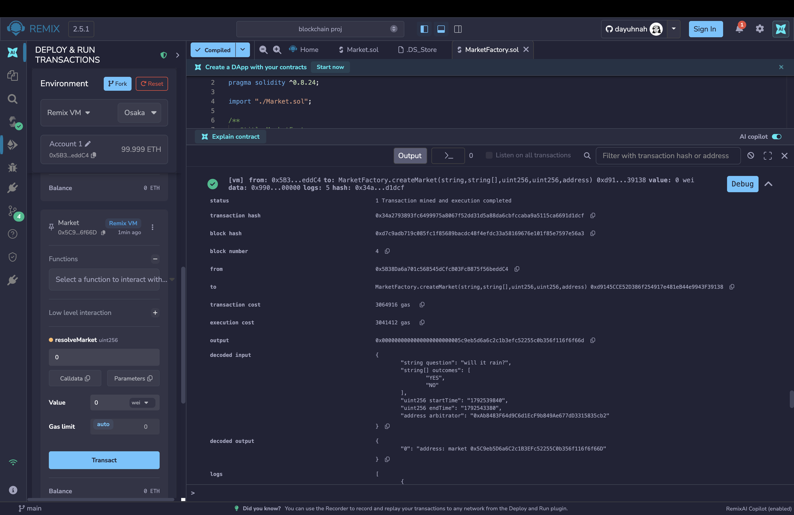

**2. Creator tries to resolve - reverts with NotArbitrator**

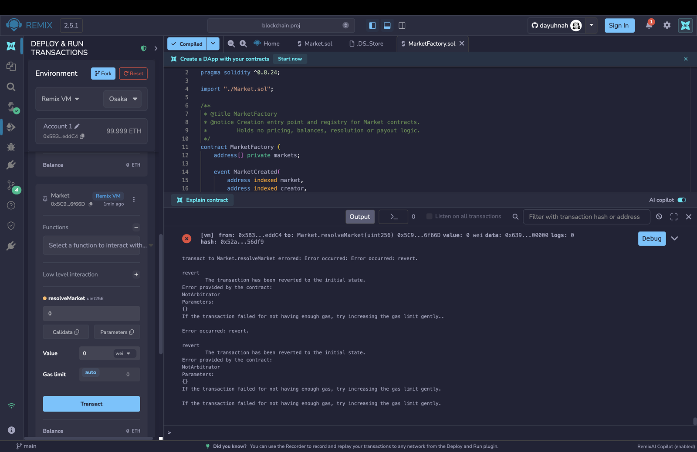

**3. Arbitrator tries to resolve before end time - reverts with MarketNotEnded**

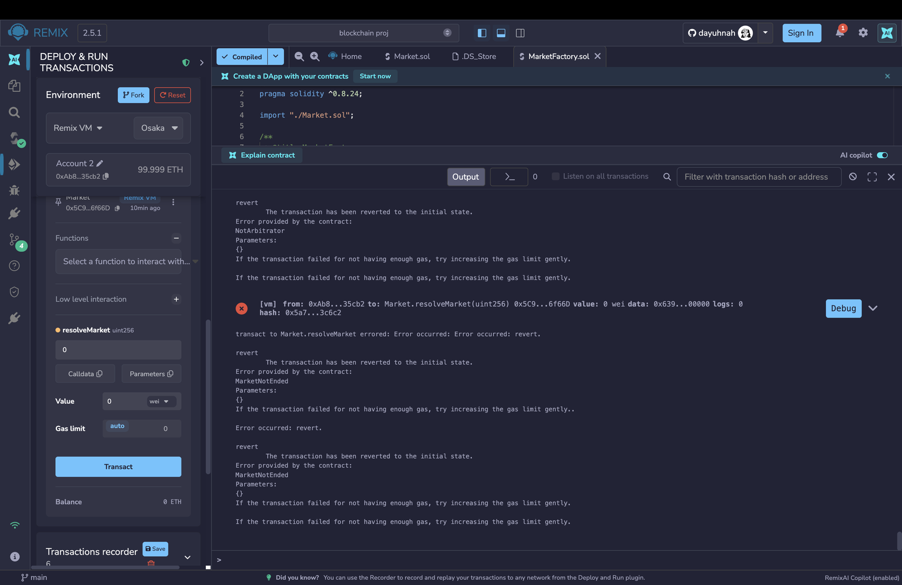

**4. Arbitrator resolves after end time (outcome 0 = YES)**

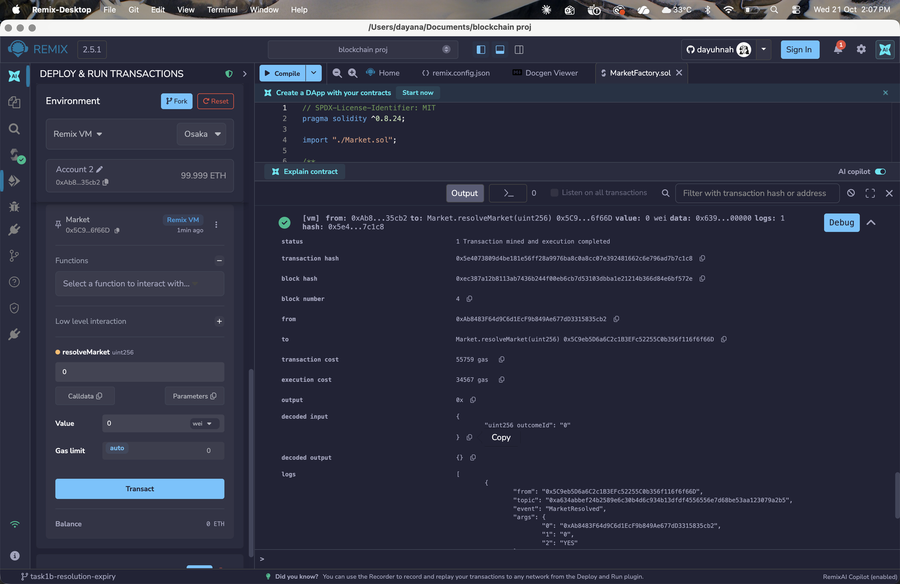

**5. status() = 3 (Resolved), winningOutcome() = 0**

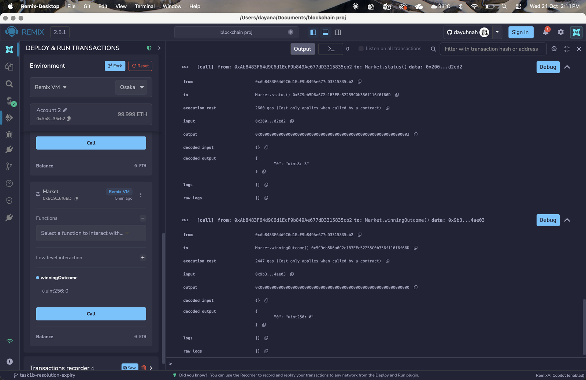

**6. Resolving again - reverts with AlreadyResolved**

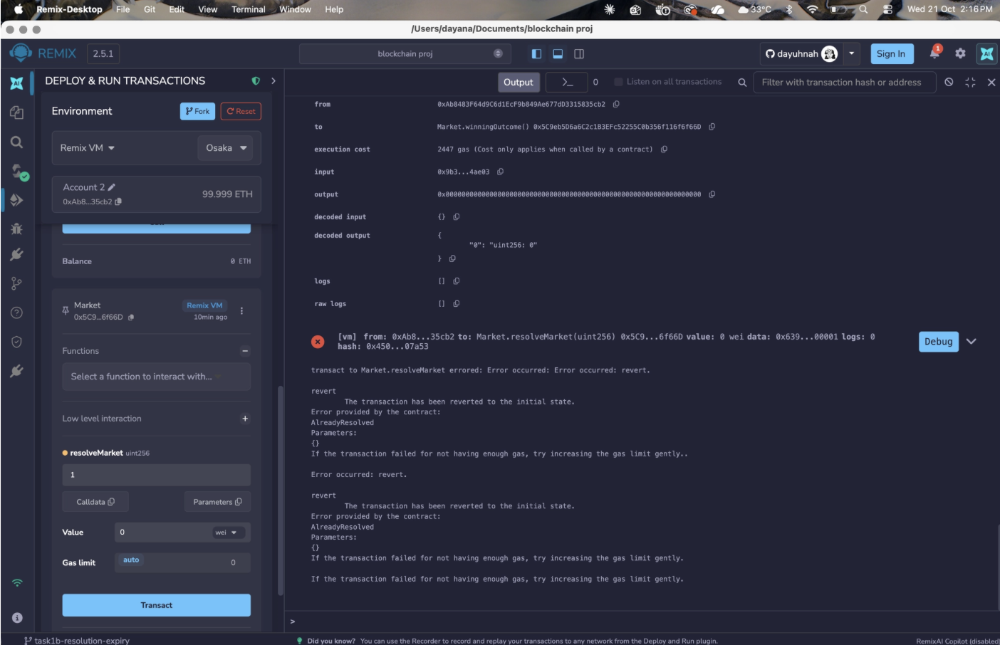

Expiry and refunds are shown in the tests above since they need 7 days to pass, which Remix can't skip.

## Task 1b, PHASE 6 & 7
Security checks and unit tests are in `test/Security.test.js`. Each test is named after an item on our 1b checklist.

What we checked:
- zero-value trades, seeds and redeems are rejected
- shares can't be created without paying (no direct mint, liquidity must be seeded, slippage guard)
- every outcome is always fully backed: pool reserve + everyone's shares = ETH in the contract
- no double payouts (claim twice, redeem in parts, transferred shares, payout + refund)
- precision: on-chain quotes are never above the exact maths and at most 2 wei below it (300 random states, 2 and 3 outcomes)
- rounding: the reserve product never goes down, and splitting a trade into 100 small ones doesn't earn extra shares
- reentrancy on buy, redeem and refund is blocked, and ETH forced in with selfdestruct doesn't break refunds
- extreme values: 1 wei pool, 1,000,000 ETH pool, 1,000,000 ETH trade, 10-outcome market
- balances stay consistent through random trading + transfers, on both the resolve path and the expiry path

Things we found (not fixed, noted as limitations):
- after a normal resolution, the leftover pool ETH has no withdraw function so it stays in the contract
- the arbitrator is not stopped from trading in a market they resolve (we trust the arbitrator, no staking/dispute in our MVP)
- buy and refund gas grows with the number of outcomes (about 100k gas for 2 outcomes, 280k for 30, 1.37M for 200)

### Test Outcomes
```
cd prediction-market
npx hardhat test
```
169 passing (126 existing + 43 new). Market.sol coverage: 100% lines.

**Full test run and coverage**

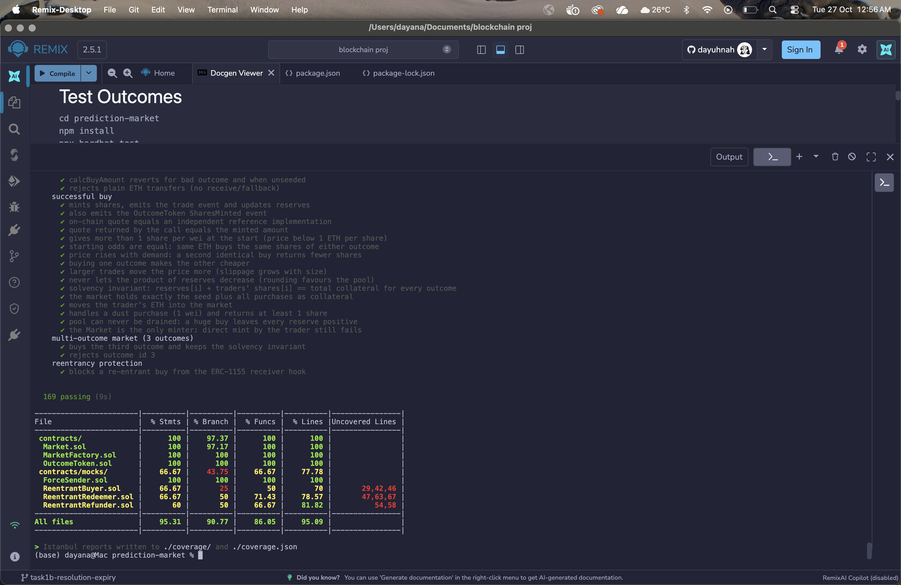

**Phase 7 unit tests**

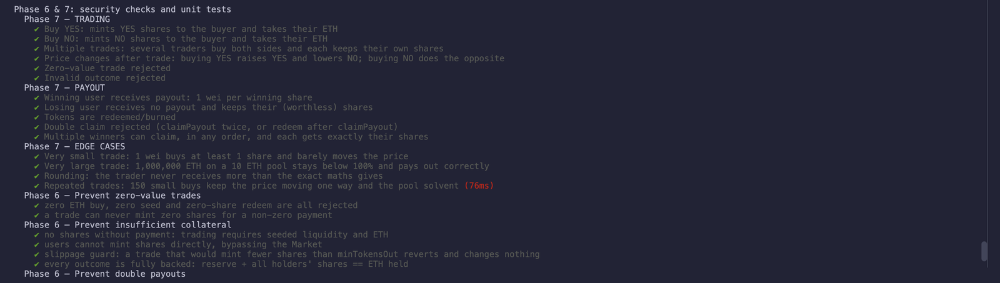

**Phase 6 security checks**

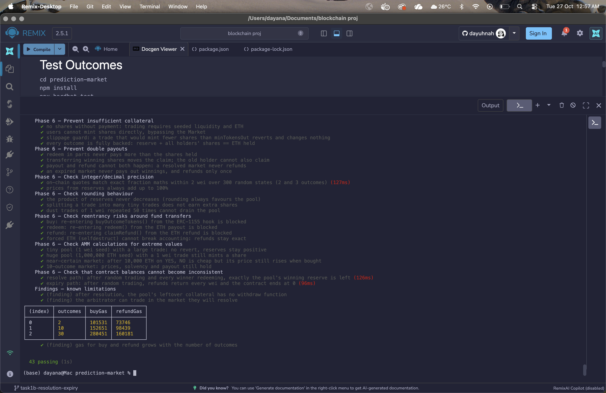

```
Phase 6 & 7: security checks and unit tests
  Phase 7 — TRADING
    ✔ Buy YES: mints YES shares to the buyer and takes their ETH
    ✔ Buy NO: mints NO shares to the buyer and takes their ETH
    ✔ Multiple trades: several traders buy both sides and each keeps their own shares
    ✔ Price changes after trade: buying YES raises YES and lowers NO; buying NO does the opposite
    ✔ Zero-value trade rejected
    ✔ Invalid outcome rejected
  Phase 7 — PAYOUT
    ✔ Winning user receives payout: 1 wei per winning share
    ✔ Losing user receives no payout and keeps their (worthless) shares
    ✔ Tokens are redeemed/burned
    ✔ Double claim rejected (claimPayout twice, or redeem after claimPayout)
    ✔ Multiple winners can claim, in any order, and each gets exactly their shares
  Phase 7 — EDGE CASES
    ✔ Very small trade: 1 wei buys at least 1 share and barely moves the price
    ✔ Very large trade: 1,000,000 ETH on a 10 ETH pool stays below 100% and pays out correctly
    ✔ Rounding: the trader never receives more than the exact maths gives
    ✔ Repeated trades: 150 small buys keep the price moving one way and the pool solvent
  Phase 6 — Prevent zero-value trades
    ✔ zero ETH buy, zero seed and zero-share redeem are all rejected
    ✔ a trade can never mint zero shares for a non-zero payment
  Phase 6 — Prevent insufficient collateral
    ✔ no shares without payment: trading requires seeded liquidity and ETH
    ✔ users cannot mint shares directly, bypassing the Market
    ✔ slippage guard: a trade that would mint fewer shares than minTokensOut reverts and changes nothing
    ✔ every outcome is fully backed: reserve + all holders' shares == ETH held
  Phase 6 — Prevent double payouts
    ✔ redeem in parts never pays more than the shares held
    ✔ transferring winning shares moves the claim; the old holder cannot also claim
    ✔ payout and refund cannot both happen: a resolved market never refunds
    ✔ an expired market never pays out winnings, and refunds only once
  Phase 6 — Check integer/decimal precision
    ✔ on-chain quotes match exact fraction maths within 2 wei over 300 random states (2 and 3 outcomes)
    ✔ prices from reserves always add up to 100%
  Phase 6 — Check rounding behaviour
    ✔ the product of reserves never decreases (rounding always favours the pool)
    ✔ splitting a trade into many tiny trades does not earn extra shares
    ✔ dust trades of 1 wei repeated 50 times cannot drain the pool
  Phase 6 — Check reentrancy risks around fund transfers
    ✔ buy: re-entering buyOutcomeTokens() from the ERC-1155 hook is blocked
    ✔ redeem: re-entering redeem() from the ETH payout is blocked
    ✔ refund: re-entering claimRefund() from the ETH refund is blocked
    ✔ forced ETH (selfdestruct) cannot break accounting: refunds stay exact
  Phase 6 — Check AMM calculations for extreme values
    ✔ tiny pool (1 wei seed) with a large trade: no revert, reserves stay positive
    ✔ huge pool (1,000,000 ETH seed) with a 1 wei trade still mints a share
    ✔ near-certain market: after 10,000 ETH on YES, NO is cheap but its price still rises when bought
    ✔ 10-outcome market: prices, solvency and payout still hold
  Phase 6 — Check that contract balances cannot become inconsistent
    ✔ resolve path: after random trading and every winner redeeming, exactly the pool's winning reserve is left
    ✔ expiry path: after random trading, refunds return every wei and the contract ends at 0
  Findings — known limitations
    ✔ (finding) after resolution, the pool's leftover collateral has no withdraw function
    ✔ (finding) the arbitrator can trade in the market they will resolve
┌─────────┬──────────┬────────┬───────────┐
│ (index) │ outcomes │ buyGas │ refundGas │
├─────────┼──────────┼────────┼───────────┤
│ 0       │ 2        │ 101531 │ 73746     │
│ 1       │ 10       │ 152651 │ 98439     │
│ 2       │ 30       │ 280451 │ 160181    │
└─────────┴──────────┴────────┴───────────┘
    ✔ (finding) gas for buy and refund grows with the number of outcomes
43 passing (7s)
```

## Task 2a, Wallet & Contract Interface
The frontend talks to the contracts through `frontend/src/contracts/` and connects MetaMask through `frontend/src/wallet/`.

- `prediction-market/scripts/deploy.js` deploys the factory, creates 3 sample markets and writes the addresses and ABIs into `frontend/src/contracts/`
- `frontend/src/contracts/index.ts` has the helpers for the UI: `readAllMarkets()`, `readMarket()`, `readPosition()`, `quoteBuy()`, `buyShares()`, `claimPayout()`, `claimRefund()`, `resolveMarket()` and `readableError()` (turns contract errors into plain messages)
- `useWallet()` gives any component the connected `account` and a `signer` for sending transactions
- the Connect Wallet button handles no wallet, wrong network (switches to Hardhat Local) and disconnect

### Contract addresses and ABIs
Local Hardhat network: chain ID `31337`, RPC `http://127.0.0.1:8545`.
A fresh `npx hardhat node` + `scripts/deploy.js` always gives these same addresses.

| Contract | Address |
|---|---|
| MarketFactory | `0x5FbDB2315678afecb367f032d93F642f64180aa3` |
| Market: Will ETH be above $5,000 on 31 Dec 2026? | `0xa16E02E87b7454126E5E10d957A927A7F5B5d2be` |
| Market: Will it rain at NTU tomorrow? | `0xB7A5bd0345EF1Cc5E66bf61BdeC17D2461fBd968` |
| Market: Will our demo run without bugs? | `0xeEBe00Ac0756308ac4AaBfD76c05c4F3088B8883` |
| Arbitrator (account #1) | `0x70997970C51812dc3A010C7d01b50e0d17dc79C8` |

Each market's OutcomeToken address can be read with `market.outcomeToken()`.

| File | What's in it |
|---|---|
| `frontend/src/contracts/deployments.json` | the addresses above |
| `frontend/src/contracts/abis/MarketFactory.json` | MarketFactory ABI |
| `frontend/src/contracts/abis/Market.json` | Market ABI (trading, resolve, payout, refund, status, errors) |
| `frontend/src/contracts/abis/OutcomeToken.json` | OutcomeToken ABI (ERC-1155) |

In the frontend you don't need to copy these, just import the helpers:
```ts
import { readAllMarkets, buyShares, claimPayout, claimRefund, deployments } from "../contracts";
```

### Wallet testing
Tested in Chrome with MetaMask on the Hardhat Local network, using test account #2.

**1. Connected - shows the address and the live balance from the chain (9996 ETH after the deploy script's sample trades)**

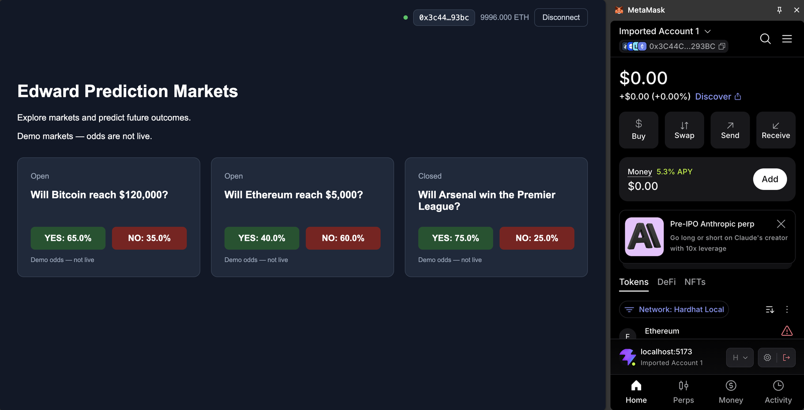

**2. Wrong network - MetaMask switched to Ethereum, so the balance is hidden and the site offers to switch back**

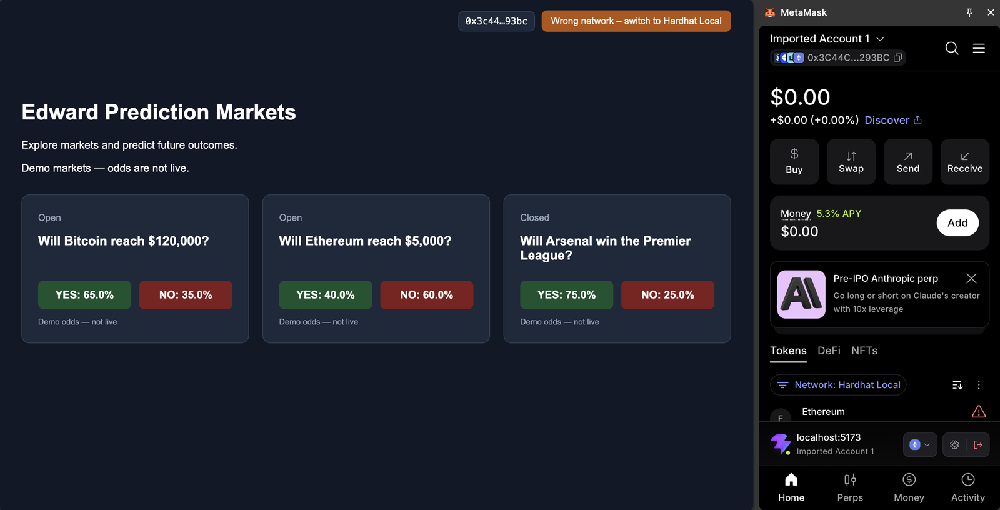

**3. Disconnected - back to Connect Wallet (the site forgets the account; MetaMask itself stays connected until you remove the site there)**

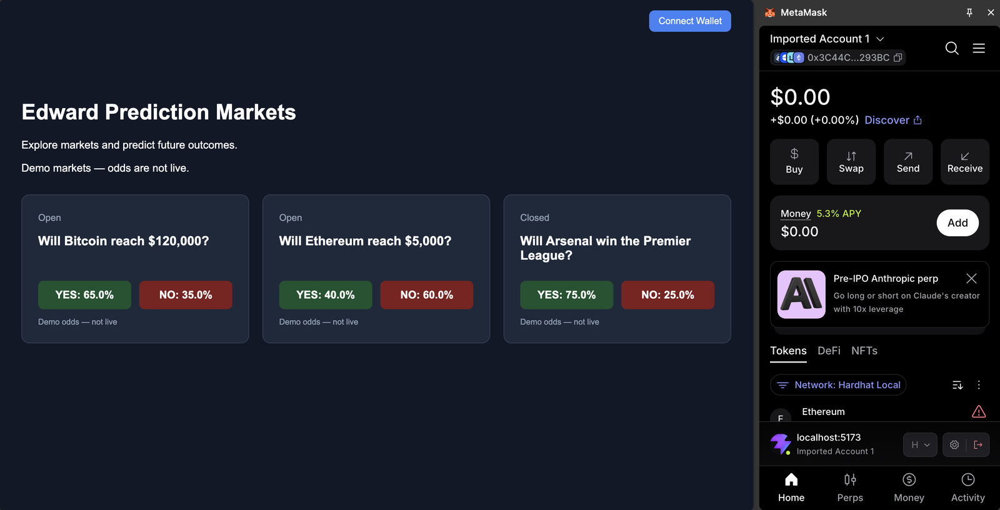

Also checked: Safari (no wallet) shows "Install MetaMask", clicking the switch button returns to Hardhat Local, and reconnecting works.

### Complete user flow test
Tested through the real website in a browser (local Hardhat chain, wallet = test account #3). Every step passed with no page errors.

| Step | Checked |
|---|---|
| Market list | 3 real markets loaded from the factory, live odds, "Trading is open" |
| Before connecting | "Connect your wallet to trade" |
| Buy | amount 0 and "abc" keep Confirm disabled; quote shown first; buying YES shows "Purchase successful!" with the transaction hash; odds go up |
| After end time | "Trading closed", buy panel hidden |
| Resolved | "Winning outcome: YES", eligible winnings shown, Claim Winnings pays exactly that amount, nothing left to claim after |
| Expired (no resolution for 7 days) | "Market expired", refund of the 0.4 ETH paid, nothing left to refund after |

**1. Before buying - quote shown for 1 ETH**

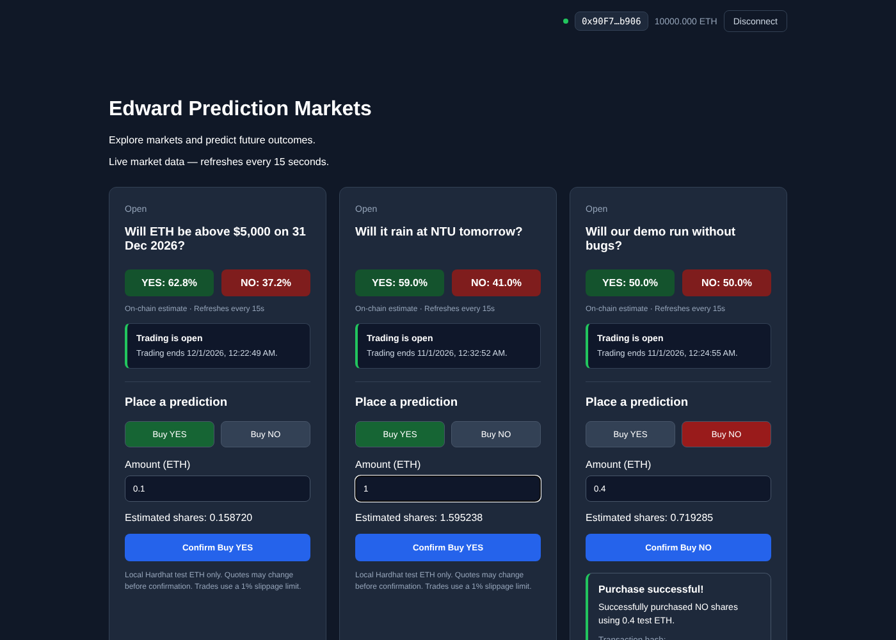

**2. After buying - Purchase successful with transaction hash**

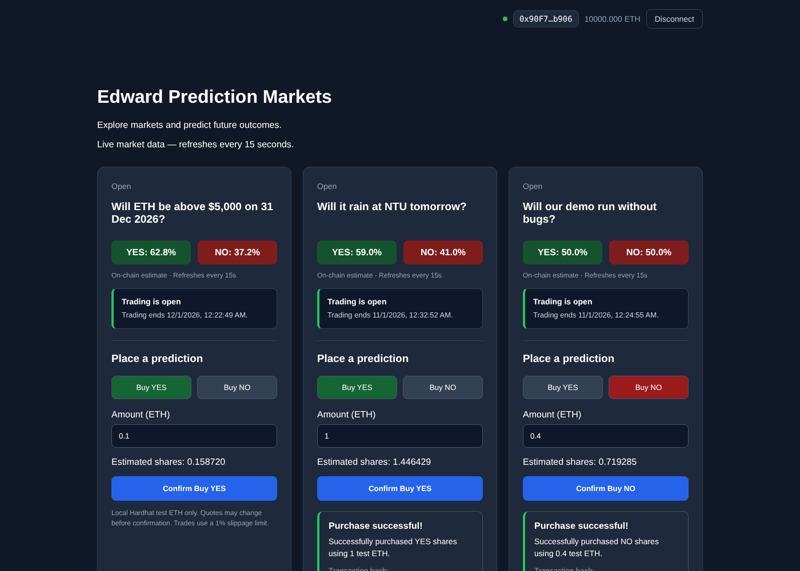

**3. Market resolved - winnings ready to claim (the other cards show Open and Closed)**

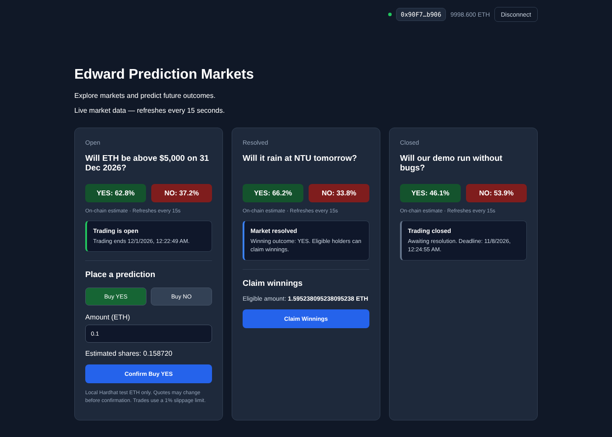

**4. Winnings claimed**

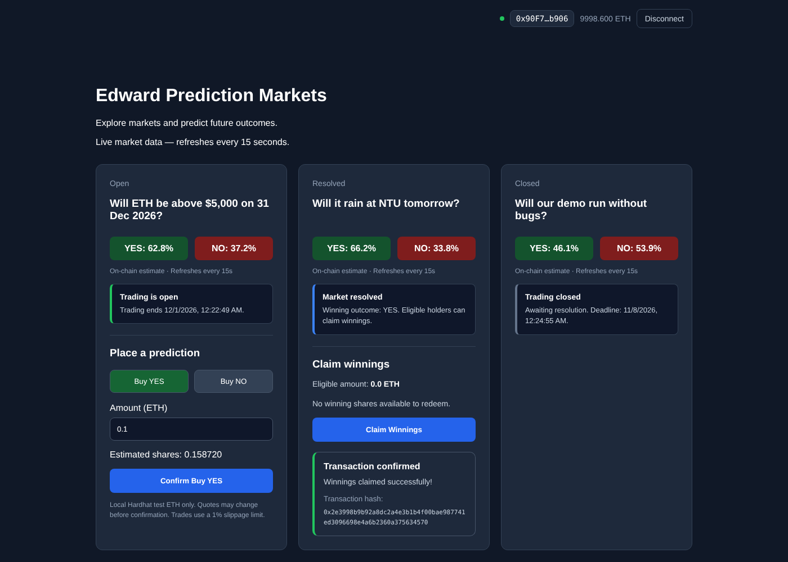

**5. Market expired - refund**

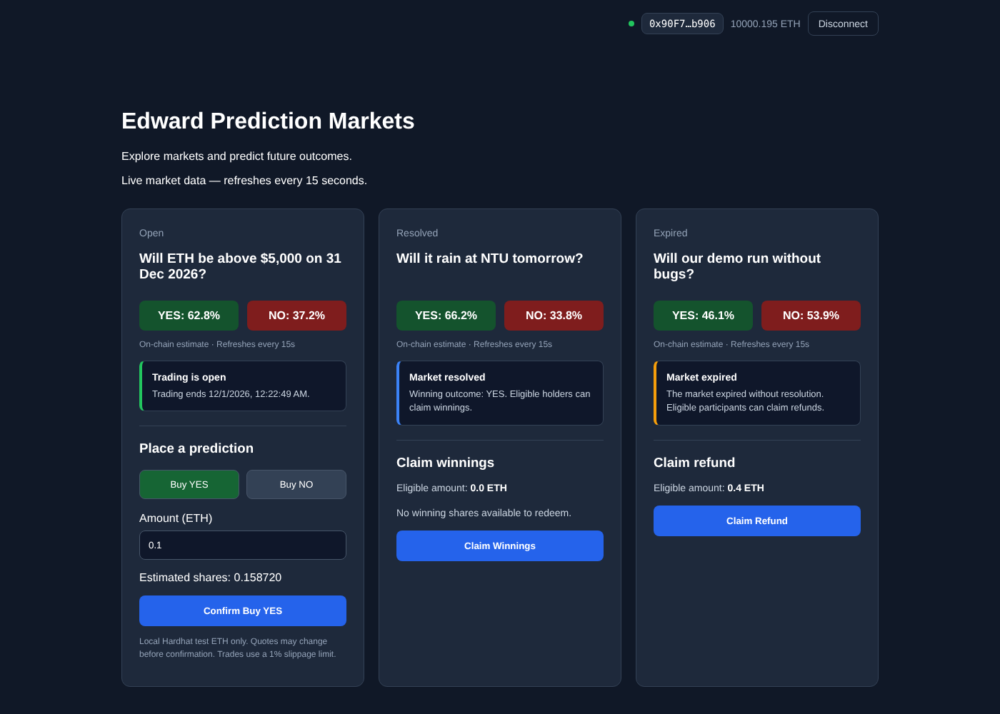

### Running it locally
Terminal 1, start a local chain:
```
cd prediction-market
npx hardhat node
```
Terminal 2, deploy and start the website:
```
cd prediction-market
npx hardhat run scripts/deploy.js --network localhost
cd ../frontend
npm install
npm run dev
```
Open http://localhost:5173.

MetaMask setup (once):
- add a network: name `Hardhat Local`, RPC `http://127.0.0.1:8545`, chain ID `31337`, symbol `ETH`
- import a test account using a private key printed by `npx hardhat node` (use account #2 or higher; #0 is the creator and #1 is the arbitrator)
- these are public test keys, never send real ETH to them
- if transactions get stuck after restarting the node, clear MetaMask's activity/nonce data for the account (in Settings → Advanced)

Testing helpers:
```
SECONDS=600 npx hardhat run scripts/advance-time.js --network localhost      # skip 10 minutes
MARKET=0x... OUTCOME=0 npx hardhat run scripts/resolve.js --network localhost  # resolve as the arbitrator
```

[2A.pdf](https://github.com/user-attachments/files/34143410/2A.pdf)

## Task 2b, Testing & Deployment

### Tests
```
cd prediction-market
npx hardhat test
```
212 passing. Each 2b item is covered by these files:

| 2b item | Test file |
|---|---|
| Market creation | `MarketFactory.test.js` |
| Trading & minting | `Trading.test.js`, `Security.test.js` (Phase 7 trading and edge cases) |
| Resolution | `Resolution.test.js`, `Expiry.test.js` |
| Payout | `Resolution.test.js`, `Security.test.js` (Phase 7 payout) |
| Security and failure cases | `Security.test.js` (Phase 6), `Expiry.test.js` |
| Whole system | `System.test.js` |
| Reputation voting | `ReputationWeightedVoting.test.js`, `ReputationUpdates.test.js` |

`System.test.js` runs the real deploy script, then three markets side by side (binary, 3 outcomes, binary) with six traders: one resolves YES, one resolves the third outcome, one expires. It checks that trading on one market never changes another, every winner gets exactly their shares, every refund is exact, and that across all accounts and markets no ETH is created or lost apart from gas.

### Reputation voting (bonus)
Contract: `contracts/ReputationWeightedVoting.sol`. A market can use the voting contract as its arbitrator instead of one person. Voters with reputation vote after trading ends, and each vote counts as much as the voter's reputation. When voting closes, anyone can call `finalizeVoting()`, which counts the votes and resolves the market with the winner. A tie or no votes means the market is not resolved, so after 7 days it expires and traders get refunds.

Reputation updates (`updateReputation`):

| Vote | Reputation change |
|---|---|
| Voted for the winning outcome | +1 |
| Voted for another outcome | −1, never below 1 |

Anyone can apply a voter's update, and it is also applied automatically the next time that voter votes. After a round is finalized, the admin can attach the same voting contract to a new market, so the updated reputation carries over. Voters who keep being right get more weight over time, and voters who keep being wrong get less.

`ReputationUpdates.test.js` (22 tests) covers:
- the +1/−1 updates, the minimum of 1, and that each update can only be applied once
- updates being applied automatically on the next vote
- several markets in a row, with the new weights changing later results
- a tie, and a market with 3 outcomes
- voting together with trading, payouts and refunds
- access checks: only the admin sets reputation, nobody else can resolve a voted market, and voting can't finish after the market's 7-day window

The deploy script makes one voted market, "Will it be sunny at NTU on demo day?". Locally, trading ends 5 minutes after the deploy and voting stays open 5 minutes after that. Voters are accounts #2, #3 and #4 with reputation 3, 5 and 2. Account #0 is the voting admin.

On the website, the voted market has a "Decided by reputation vote" section. It shows the weighted totals, your reputation, vote buttons while voting is open, a "Count votes and resolve market" button after the deadline, and "Apply reputation update" once the vote is counted. The admin also gets a form to give an address reputation before trading ends.

To try it locally:
1. Import accounts #2, #3 and #4 into MetaMask. `npx hardhat node` prints their private keys. These are public test keys, so only use them on the local chain.
2. Skip ahead in time with `SECONDS=300 npx hardhat run scripts/advance-time.js --network localhost`. Run it once to open voting, and again after voting to close it.

Browser test of the whole flow (admin gives reputation, three accounts vote, an account with no reputation counts the votes, reputation goes 5 → 6 and 2 → 1, the winner claims):

| Admin gives reputation | Voting open | Votes counted | Reputation update |
|---|---|---|---|
| 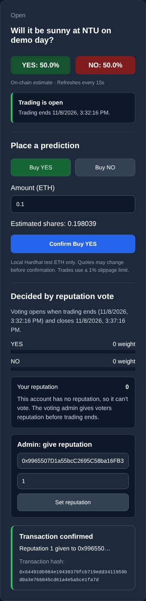 | 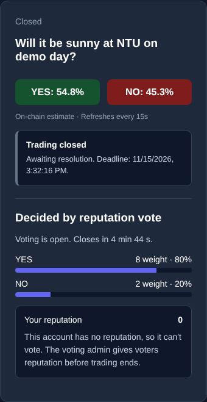 | 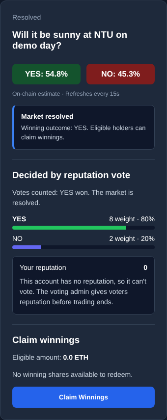 | 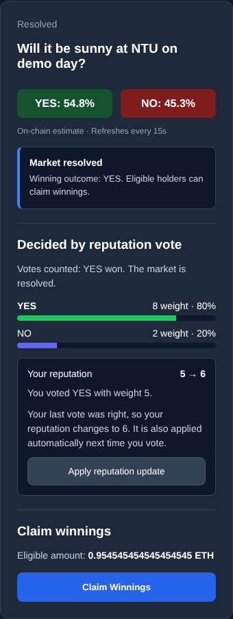 |

### Deploying to Sepolia
You need two things:
- an RPC URL for Sepolia (free from Alchemy or Infura: make an account, create an app for Ethereum Sepolia, copy the HTTPS URL)
- a **new MetaMask account used only for this**, with some free Sepolia test ETH from a faucet (about 0.05–0.1 ETH: the deploy uses about 13 million gas plus 0.015 ETH to seed three markets)

Save them in Hardhat's secret store (kept on your computer, not in the project, so they never go to GitHub):
```
cd prediction-market
npx hardhat vars set SEPOLIA_RPC_URL
npx hardhat vars set SEPOLIA_PRIVATE_KEY
```
Each command asks you to paste the value. The private key is from MetaMask: account menu, Account details, Show private key. Only ever use a test account for this.

Deploy:
```
npx hardhat run scripts/deploy.js --network sepolia
```
This writes `frontend/src/contracts/deployments.sepolia.json` and prints Etherscan links. On Sepolia your account is the creator, the arbitrator and the voting admin. There are three markets: one that ends in 30 days, one that ends in 30 minutes, and the voted market, which ends in 20 minutes and then has 10 minutes of voting. Your account gets reputation 1. To let other people vote too, add their addresses when you deploy:
```
VOTERS=0xTheirAddress:2,0xAnother:3 npx hardhat run scripts/deploy.js --network sepolia
```

Run the website against Sepolia:
```
cd ../frontend
echo "VITE_NETWORK=sepolia" > .env.sepolia
echo "VITE_RPC_URL=https://ethereum-sepolia-rpc.publicnode.com" >> .env.sepolia
npm run dev:sepolia
```
Switch MetaMask to Sepolia. After the 30-minute market ends, resolve it with
```
cd ../prediction-market
MARKET=0x... OUTCOME=0 npx hardhat run scripts/resolve.js --network sepolia
```
If the deploy stops halfway (for example "insufficient funds"), get more test ETH and run it again with the addresses it already printed, so you don't pay for them twice. Markets it already created are reused too:
```
FACTORY=0x... VOTING=0x... npx hardhat run scripts/deploy.js --network sepolia
```

Optional: `npx hardhat vars set ETHERSCAN_API_KEY` and then `npx hardhat verify --network sepolia <factory address>` publishes the source code on Etherscan.

`npm run dev` still uses the local Hardhat chain as before.

### Sepolia deployment
Deployed on 8 Nov 2026 from `0xcC898468eFA41c62bB5465A4346eb545A9520c0f` (creator, arbitrator and voting admin). Addresses are also in `frontend/src/contracts/deployments.sepolia.json`.

| Contract | Address |
|---|---|
| MarketFactory | [0x76b1daAD06D47031067eC6A90Ae638508caCfFc7](https://sepolia.etherscan.io/address/0x76b1daAD06D47031067eC6A90Ae638508caCfFc7) |
| ReputationWeightedVoting | [0x8d0b74eB7E18B4c864A3C7D6CBc709995EE162b0](https://sepolia.etherscan.io/address/0x8d0b74eB7E18B4c864A3C7D6CBc709995EE162b0) |
| Market: Will ETH be above $5,000 on 31 Dec 2026? | [0x7669933dab62ad13B17EAD2191baFc18573A0e82](https://sepolia.etherscan.io/address/0x7669933dab62ad13B17EAD2191baFc18573A0e82) |
| Market: Will our demo run without bugs? | [0xdfe6125c59ad77A9e841CD848D1Df148A4156629](https://sepolia.etherscan.io/address/0xdfe6125c59ad77A9e841CD848D1Df148A4156629) |
| Market: Will it be sunny at NTU on demo day? (decided by vote) | [0xFA2D7B8aB952fB46F28B54BF79AC2F30fA9ad059](https://sepolia.etherscan.io/address/0xFA2D7B8aB952fB46F28B54BF79AC2F30fA9ad059) |

To use it: `cd frontend && npm run dev:sepolia`, connect MetaMask on Sepolia.
