# Documentation

## Task 1a, Documentation
[Task1a_Documentation.pdf](https://github.com/user-attachments/files/33140469/Task1a_Documentation.pdf)
 ### Test Outcomes
 
 
## Task 1b, PHASE 2
[Phase2_Trading_Documentation.pdf](https://github.com/user-attachments/files/33754066/Phase2_Trading_Documentation.pdf)

## Task 1b, PHASE 3 & 5
Resolution is done with `resolve(outcomeId)` and Phase 5 adds the timeout and refunds in `Market.sol`.

- `resolve()` can only be called by the arbitrator, after endTime, once, and within 7 days of endTime
- if the arbitrator doesn't resolve within 7 days the market becomes Expired
- in an expired market everyone can call `claimRefund()` to get back what they put in (traders and the creator's seed), and their shares are burned
- `status()` returns 0 Upcoming, 1 Open, 2 Closed, 3 Resolved, 4 Expired

### Test Outcomes
```
cd prediction-market
npm install
npx hardhat test
```
126 passing (97 existing + 29 new in `test/Expiry.test.js`). Market.sol coverage: 100% lines.

```
Phase 5: expiry and timeout
  status() lifecycle
    ✔ resolution deadline is endTime + 7 days
    ✔ Upcoming → Open → Closed → Resolved
    ✔ Closed → Expired exactly at the deadline when nobody resolves
    ✔ a resolved market never becomes Expired
  resolution deadline
    ✔ arbitrator can still resolve one second before the deadline
    ✔ arbitrator cannot resolve at or after the deadline
    ✔ the arbitrator check still comes first after expiry
  no trading after endTime or expiry
    ✔ buying after endTime is rejected
    ✔ buying in an expired market is rejected
    ✔ an expired market cannot be redeemed as if resolved
  collateral tracking
    ✔ records the creator's seed and every trader's ETH
    ✔ contract balance equals the total recorded collateral
  markExpired()
    ✔ cannot be called before the deadline
    ✔ anyone can call it after the deadline; emits MarketTimedOut
    ✔ cannot be called twice
    ✔ cannot expire a resolved market
  claimRefund()
    ✔ is not allowed before expiry
    ✔ is not allowed in a resolved market, even much later
    ✔ first refund marks the market expired and emits MarketTimedOut + Refunded
    ✔ every trader gets back exactly what they paid
    ✔ the creator gets the seed back
    ✔ after everyone is refunded the contract is empty
    ✔ burns the refunded trader's shares of every outcome
    ✔ double refund is rejected
    ✔ an account that never paid has nothing to refund
    ✔ refunds go to the payer, not to whoever holds transferred shares (known limitation)
  3-outcome market
    ✔ refunds and burns across all three outcomes
  ETH transfer failure and reentrancy
    ✔ re-entering claimRefund() from inside the refund is blocked; it is paid exactly once
    ✔ a recipient that rejects ETH makes the refund revert; nothing is burned or cleared

29 passing
```

### Remix Demo (resolution)
Tested on Remix VM. Account 1 created the market and Account 2 is the arbitrator.
These were recorded on our earlier version where the function was called `resolveMarket()`. It is now `resolve()` with the same checks and errors.

**1. Create market**

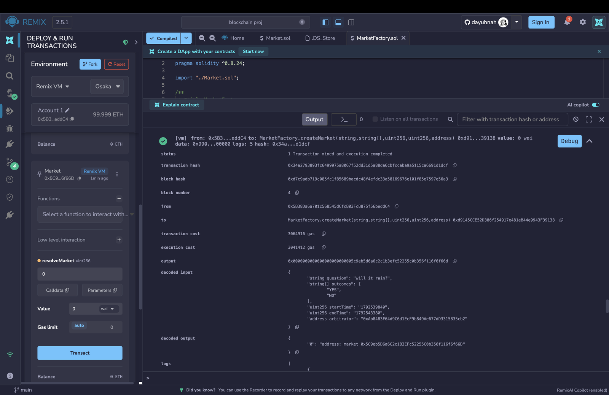

**2. Creator tries to resolve - reverts with NotArbitrator**

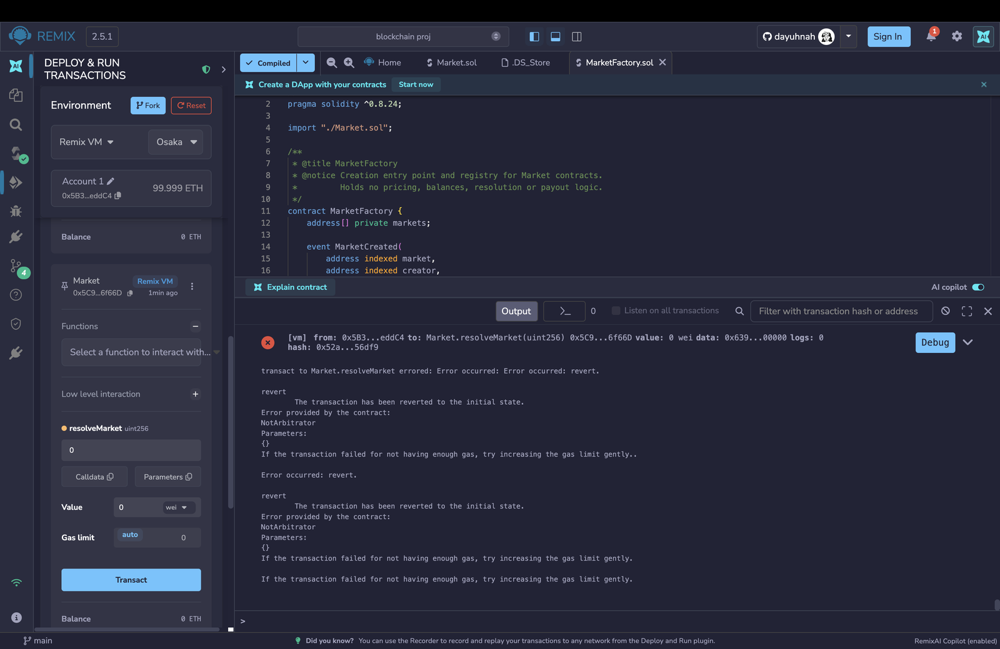

**3. Arbitrator tries to resolve before end time - reverts with MarketNotEnded**

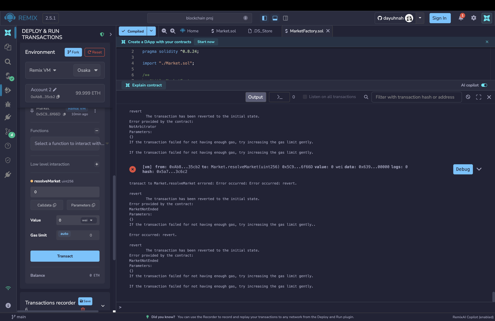

**4. Arbitrator resolves after end time (outcome 0 = YES)**

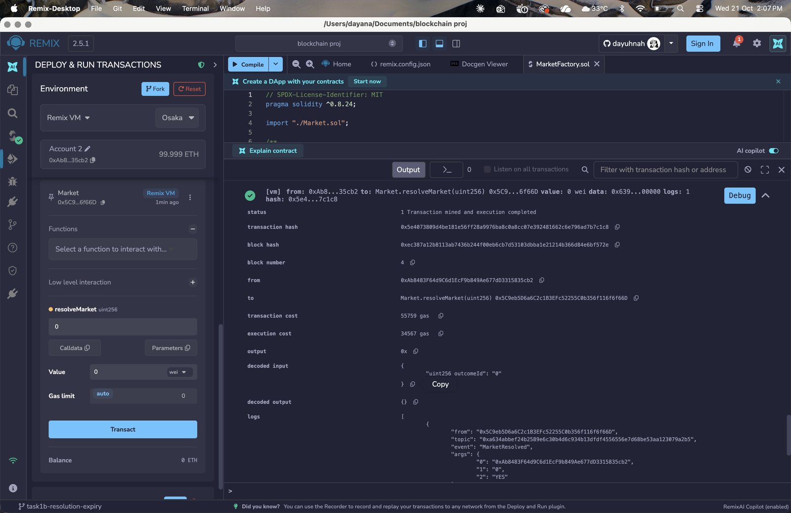

**5. status() = 3 (Resolved), winningOutcome() = 0**

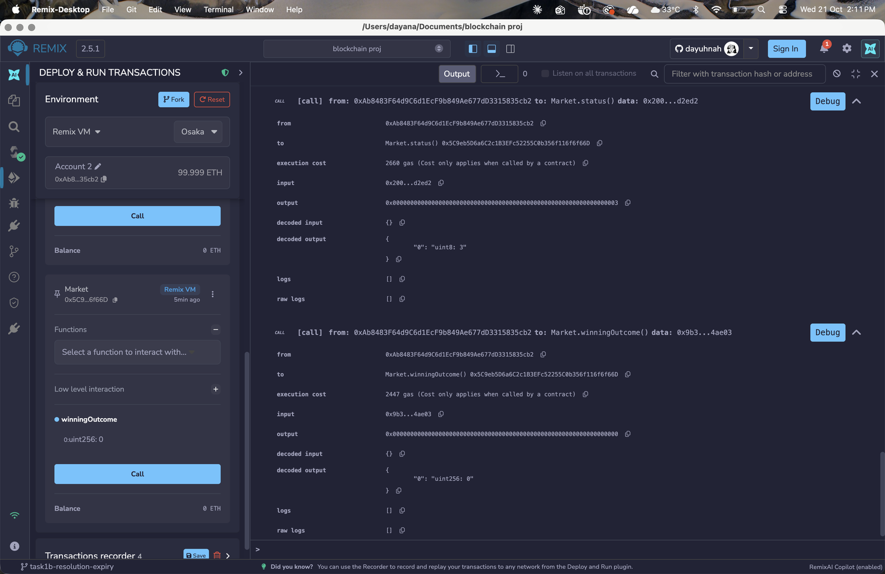

**6. Resolving again - reverts with AlreadyResolved**

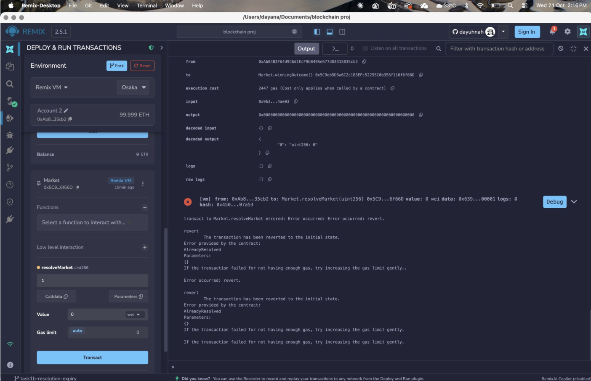

Expiry and refunds are shown in the tests above since they need 7 days to pass, which Remix can't skip.

## Task 1b, PHASE 6 & 7
Security checks and unit tests are in `test/Security.test.js`. Each test is named after an item on our 1b checklist.

What we checked:
- zero-value trades, seeds and redeems are rejected
- shares can't be created without paying (no direct mint, liquidity must be seeded, slippage guard)
- every outcome is always fully backed: pool reserve + everyone's shares = ETH in the contract
- no double payouts (claim twice, redeem in parts, transferred shares, payout + refund)
- precision: on-chain quotes are never above the exact maths and at most 2 wei below it (300 random states, 2 and 3 outcomes)
- rounding: the reserve product never goes down, and splitting a trade into 100 small ones doesn't earn extra shares
- reentrancy on buy, redeem and refund is blocked, and ETH forced in with selfdestruct doesn't break refunds
- extreme values: 1 wei pool, 1,000,000 ETH pool, 1,000,000 ETH trade, 10-outcome market
- balances stay consistent through random trading + transfers, on both the resolve path and the expiry path

Things we found (not fixed, noted as limitations):
- after a normal resolution, the leftover pool ETH has no withdraw function so it stays in the contract
- the arbitrator is not stopped from trading in a market they resolve (we trust the arbitrator, no staking/dispute in our MVP)
- buy and refund gas grows with the number of outcomes (about 100k gas for 2 outcomes, 280k for 30, 1.37M for 200)

### Test Outcomes
```
cd prediction-market
npx hardhat test
```
169 passing (126 existing + 43 new). Market.sol coverage: 100% lines.

**Full test run and coverage**

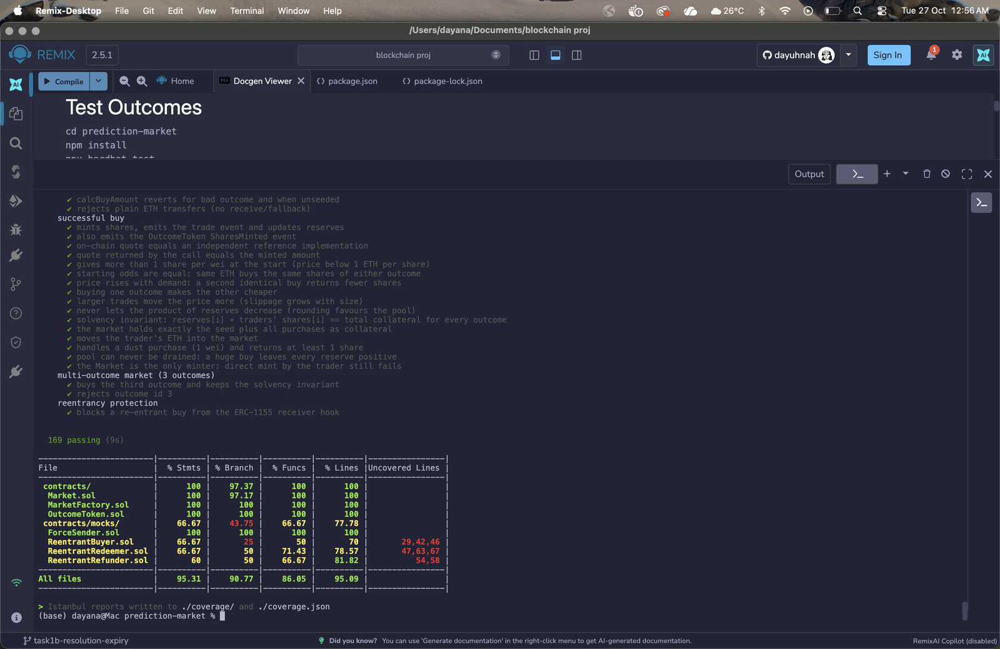

**Phase 7 unit tests**

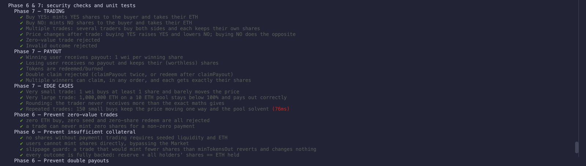

**Phase 6 security checks**

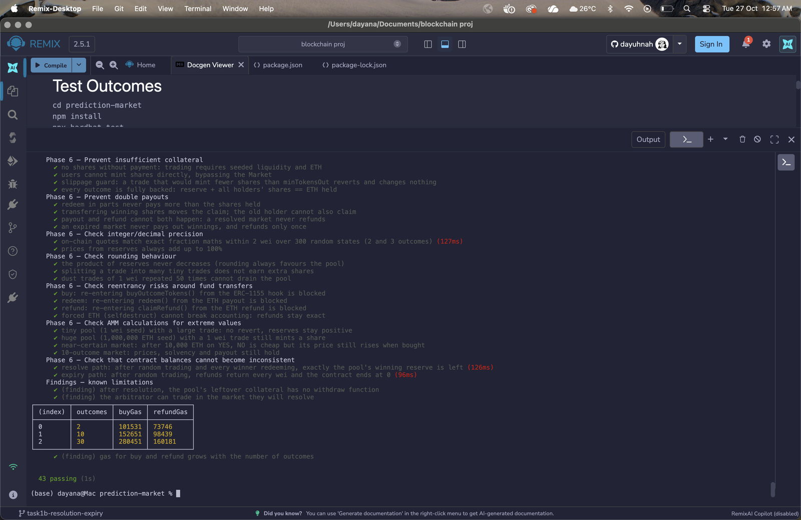

```
Phase 6 & 7: security checks and unit tests
  Phase 7 — TRADING
    ✔ Buy YES: mints YES shares to the buyer and takes their ETH
    ✔ Buy NO: mints NO shares to the buyer and takes their ETH
    ✔ Multiple trades: several traders buy both sides and each keeps their own shares
    ✔ Price changes after trade: buying YES raises YES and lowers NO; buying NO does the opposite
    ✔ Zero-value trade rejected
    ✔ Invalid outcome rejected
  Phase 7 — PAYOUT
    ✔ Winning user receives payout: 1 wei per winning share
    ✔ Losing user receives no payout and keeps their (worthless) shares
    ✔ Tokens are redeemed/burned
    ✔ Double claim rejected (claimPayout twice, or redeem after claimPayout)
    ✔ Multiple winners can claim, in any order, and each gets exactly their shares
  Phase 7 — EDGE CASES
    ✔ Very small trade: 1 wei buys at least 1 share and barely moves the price
    ✔ Very large trade: 1,000,000 ETH on a 10 ETH pool stays below 100% and pays out correctly
    ✔ Rounding: the trader never receives more than the exact maths gives
    ✔ Repeated trades: 150 small buys keep the price moving one way and the pool solvent
  Phase 6 — Prevent zero-value trades
    ✔ zero ETH buy, zero seed and zero-share redeem are all rejected
    ✔ a trade can never mint zero shares for a non-zero payment
  Phase 6 — Prevent insufficient collateral
    ✔ no shares without payment: trading requires seeded liquidity and ETH
    ✔ users cannot mint shares directly, bypassing the Market
    ✔ slippage guard: a trade that would mint fewer shares than minTokensOut reverts and changes nothing
    ✔ every outcome is fully backed: reserve + all holders' shares == ETH held
  Phase 6 — Prevent double payouts
    ✔ redeem in parts never pays more than the shares held
    ✔ transferring winning shares moves the claim; the old holder cannot also claim
    ✔ payout and refund cannot both happen: a resolved market never refunds
    ✔ an expired market never pays out winnings, and refunds only once
  Phase 6 — Check integer/decimal precision
    ✔ on-chain quotes match exact fraction maths within 2 wei over 300 random states (2 and 3 outcomes)
    ✔ prices from reserves always add up to 100%
  Phase 6 — Check rounding behaviour
    ✔ the product of reserves never decreases (rounding always favours the pool)
    ✔ splitting a trade into many tiny trades does not earn extra shares
    ✔ dust trades of 1 wei repeated 50 times cannot drain the pool
  Phase 6 — Check reentrancy risks around fund transfers
    ✔ buy: re-entering buyOutcomeTokens() from the ERC-1155 hook is blocked
    ✔ redeem: re-entering redeem() from the ETH payout is blocked
    ✔ refund: re-entering claimRefund() from the ETH refund is blocked
    ✔ forced ETH (selfdestruct) cannot break accounting: refunds stay exact
  Phase 6 — Check AMM calculations for extreme values
    ✔ tiny pool (1 wei seed) with a large trade: no revert, reserves stay positive
    ✔ huge pool (1,000,000 ETH seed) with a 1 wei trade still mints a share
    ✔ near-certain market: after 10,000 ETH on YES, NO is cheap but its price still rises when bought
    ✔ 10-outcome market: prices, solvency and payout still hold
  Phase 6 — Check that contract balances cannot become inconsistent
    ✔ resolve path: after random trading and every winner redeeming, exactly the pool's winning reserve is left
    ✔ expiry path: after random trading, refunds return every wei and the contract ends at 0
  Findings — known limitations
    ✔ (finding) after resolution, the pool's leftover collateral has no withdraw function
    ✔ (finding) the arbitrator can trade in the market they will resolve
┌─────────┬──────────┬────────┬───────────┐
│ (index) │ outcomes │ buyGas │ refundGas │
├─────────┼──────────┼────────┼───────────┤
│ 0       │ 2        │ 101531 │ 73746     │
│ 1       │ 10       │ 152651 │ 98439     │
│ 2       │ 30       │ 280451 │ 160181    │
└─────────┴──────────┴────────┴───────────┘
    ✔ (finding) gas for buy and refund grows with the number of outcomes
43 passing (7s)
```

## Task 2a, Wallet & Contract Interface
The frontend talks to the contracts through `frontend/src/contracts/` and connects MetaMask through `frontend/src/wallet/`.

- `prediction-market/scripts/deploy.js` deploys the factory, creates 3 sample markets and writes the addresses and ABIs into `frontend/src/contracts/`
- `frontend/src/contracts/index.ts` has the helpers for the UI: `readAllMarkets()`, `readMarket()`, `readPosition()`, `quoteBuy()`, `buyShares()`, `claimPayout()`, `claimRefund()`, `resolveMarket()` and `readableError()` (turns contract errors into plain messages)
- `useWallet()` gives any component the connected `account` and a `signer` for sending transactions
- the Connect Wallet button handles no wallet, wrong network (switches to Hardhat Local) and disconnect

### Contract addresses and ABIs
Local Hardhat network: chain ID `31337`, RPC `http://127.0.0.1:8545`.
A fresh `npx hardhat node` + `scripts/deploy.js` always gives these same addresses.

| Contract | Address |
|---|---|
| MarketFactory | `0x5FbDB2315678afecb367f032d93F642f64180aa3` |
| Market: Will ETH be above $5,000 on 31 Dec 2026? | `0xa16E02E87b7454126E5E10d957A927A7F5B5d2be` |
| Market: Will it rain at NTU tomorrow? | `0xB7A5bd0345EF1Cc5E66bf61BdeC17D2461fBd968` |
| Market: Will our demo run without bugs? | `0xeEBe00Ac0756308ac4AaBfD76c05c4F3088B8883` |
| Arbitrator (account #1) | `0x70997970C51812dc3A010C7d01b50e0d17dc79C8` |

Each market's OutcomeToken address can be read with `market.outcomeToken()`.

| File | What's in it |
|---|---|
| `frontend/src/contracts/deployments.json` | the addresses above |
| `frontend/src/contracts/abis/MarketFactory.json` | MarketFactory ABI |
| `frontend/src/contracts/abis/Market.json` | Market ABI (trading, resolve, payout, refund, status, errors) |
| `frontend/src/contracts/abis/OutcomeToken.json` | OutcomeToken ABI (ERC-1155) |

In the frontend you don't need to copy these, just import the helpers:
```ts
import { readAllMarkets, buyShares, claimPayout, claimRefund, deployments } from "../contracts";
```

### Wallet testing
Tested in Chrome with MetaMask on the Hardhat Local network, using test account #2.

**1. Connected - shows the address and the live balance from the chain (9996 ETH after the deploy script's sample trades)**

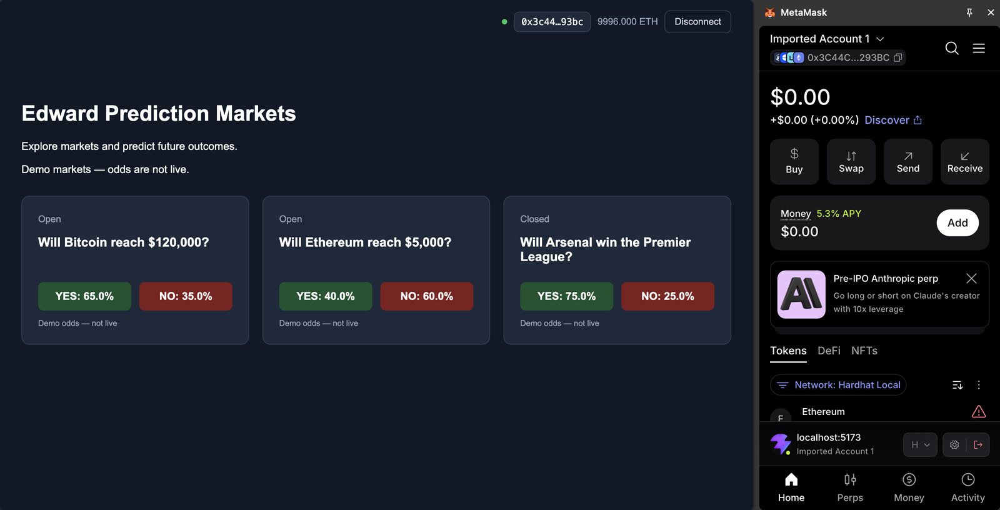

**2. Wrong network - MetaMask switched to Ethereum, so the balance is hidden and the site offers to switch back**

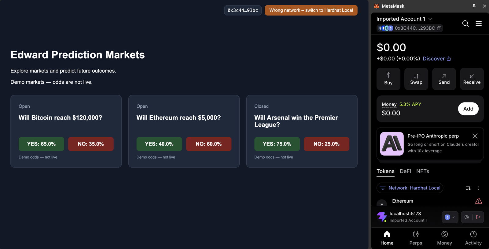

**3. Disconnected - back to Connect Wallet (the site forgets the account; MetaMask itself stays connected until you remove the site there)**

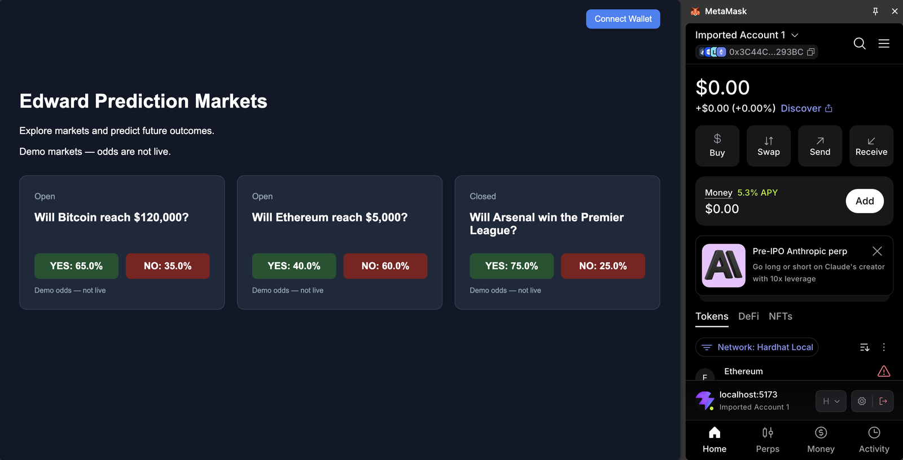

Also checked: Safari (no wallet) shows "Install MetaMask", clicking the switch button returns to Hardhat Local, and reconnecting works.

### Running it locally
Terminal 1, start a local chain:
```
cd prediction-market
npx hardhat node
```
Terminal 2, deploy and start the website:
```
cd prediction-market
npx hardhat run scripts/deploy.js --network localhost
cd ../frontend
npm install
npm run dev
```
Open http://localhost:5173.

MetaMask setup (once):
- add a network: name `Hardhat Local`, RPC `http://127.0.0.1:8545`, chain ID `31337`, symbol `ETH`
- import a test account using a private key printed by `npx hardhat node` (use account #2 or higher; #0 is the creator and #1 is the arbitrator)
- these are public test keys, never send real ETH to them
- if transactions get stuck after restarting the node, clear MetaMask's activity/nonce data for the account (in Settings → Advanced)

Testing helpers:
```
SECONDS=600 npx hardhat run scripts/advance-time.js --network localhost      # skip 10 minutes
MARKET=0x... OUTCOME=0 npx hardhat run scripts/resolve.js --network localhost  # resolve as the arbitrator
```

[2A.pdf](https://github.com/user-attachments/files/34143410/2A.pdf)
